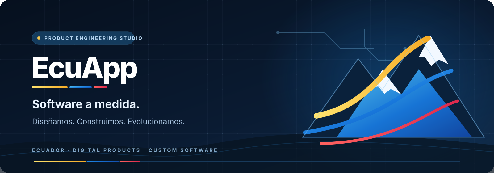

  

  
  
  

<h2 align="center">Ideas que se convierten en software. Tecnología que evoluciona.</h2>

  Somos una startup tecnológica ecuatoriana que diseña, desarrolla y hace evolucionar
  <strong>software a medida</strong>, plataformas digitales y productos propios.
  Combinamos visión de producto, ingeniería y mejora continua para convertir retos reales
  en soluciones útiles, seguras y escalables.

---

## Qué hacemos

No partimos de una plantilla para forzar un problema. Entendemos cómo funciona cada organización, diseñamos la solución adecuada y construimos el software alrededor de sus objetivos.

<table>
  <tr>
    <td width="50%" valign="top">
      <h3>01 · Software a medida</h3>
      Aplicaciones y sistemas creados alrededor de procesos, reglas de negocio y necesidades concretas.
    </td>
    <td width="50%" valign="top">
      <h3>02 · Plataformas web</h3>
      Portales, sistemas administrativos, dashboards y productos digitales preparados para crecer.
    </td>
  </tr>
  <tr>
    <td width="50%" valign="top">
      <h3>03 · APIs e integración</h3>
      Servicios backend, automatización de procesos e interoperabilidad entre plataformas.
    </td>
    <td width="50%" valign="top">
      <h3>04 · Inteligencia artificial</h3>
      Agentes de IA, procesamiento de información, visión por computador y flujos inteligentes.
    </td>
  </tr>
  <tr>
    <td width="50%" valign="top">
      <h3>05 · Productos especializados</h3>
      Herramientas para sectores y operaciones que necesitan soluciones específicas.
    </td>
    <td width="50%" valign="top">
      <h3>06 · Evolución de software</h3>
      Arquitectura, modernización, calidad, seguridad, mantenimiento y nuevas capacidades.
    </td>
  </tr>
</table>

## Productos y proyectos

Construimos productos propios y soluciones especializadas. Cada iniciativa avanza a su ritmo: hacemos visible su estado real porque creemos que la confianza también se construye con transparencia.

<table>
  <tr>
    <td width="50%" valign="top">
      <h3>🧠 Mnemosine</h3>
      <strong>Project Memory OS · Ingeniería de software con IA</strong>
      
Una plataforma que conserva el contexto de los proyectos, organiza su conocimiento y coordina el trabajo de agentes de inteligencia artificial con tareas, documentación y repositorios.

      
      
La validación integral en entornos reales y la preparación para producción continúan.

    </td>
    <td width="50%" valign="top">
      <h3>✍️ PDF Sign EC</h3>
      <strong>Firma electrónica · Extensión de Chrome</strong>
      
Experiencia integrada para consultar, visualizar y gestionar documentos PDF y flujos de firma electrónica desde el navegador.

      
      
La validación final de los flujos de firma reales forma parte de la preparación de lanzamiento.

    </td>
  </tr>
  <tr>
    <td width="50%" valign="top">
      <h3>◈ Helios Biometrics</h3>
      <strong>Biometría · Computer vision · APIs</strong>
      
Plataforma de análisis de imágenes y video con capacidades de extracción facial, validación de identidad, prueba de vida, detección de objetos, análisis de emoción y verificación especializada.

      
      
Probado en entornos controlados con datos sintéticos. No está habilitado para producción ni para decisiones sobre personas reales; requiere cerrar validaciones legales y de calibración.

    </td>
    <td width="50%" valign="top">
      <h3>🏫 Cúspide</h3>
      <strong>EdTech · Gestión educativa multiinstitucional</strong>
      
Plataforma orientada a administrar instituciones, clases, estudiantes, personal, actividades pagadas, productos e inventario bajo una estructura multiinstitución.

      
    </td>
  </tr>
  <tr>
    <td width="50%" valign="top">
      <h3>✚ Clínica Estándar</h3>
      <strong>HealthTech · Gestión de clínicas</strong>
      
Portal web y sistema operativo para clínicas: información pública, especialidades, profesionales, reservas de citas, agenda y administración por roles.

      
      
Continúa el trabajo de calidad, accesibilidad, pruebas y preparación operativa.

    </td>
    <td width="50%" valign="top">
      <h3>◉ Fitness</h3>
      <strong>Wellness Tech · Seguimiento y visualización 3D</strong>
      
Producto mobile-first enfocado en registrar mediciones, visualizar la evolución corporal y explorar escenarios de hábitos y actividad mediante experiencias visuales.

      
      
Las funciones avanzadas de cuenta, avatar, predicciones y servicios asociados siguen en construcción.

    </td>
  </tr>
</table>

### En nuestro laboratorio de producto

**Hefesto · Gestión empresarial e inventario.** Diseño de un sistema para controlar existencias, compras, ventas, almacenes, sucursales, caja, permisos y trazabilidad. Actualmente en definición funcional y arquitectura.

> Los estados describen el avance de ingeniería, no una promesa de disponibilidad comercial. Cada producto debe superar sus propias pruebas, validaciones de seguridad y requisitos operativos antes de ofrecerse en producción.

## Nuestro stack tecnológico

Elegimos las herramientas según el problema, el contexto y el ciclo de vida de cada producto. Este es el conjunto de lenguajes y tecnologías que ya aparece en nuestros proyectos.

**Lenguajes**

  
  
  
  
  

**Frontend y experiencia digital**

  
  
  
  
  
  

**Backend, datos y servicios**

  
  
  
  
  
  

**IA, automatización y visión por computador**

  
  
  
  
  

También integramos servicios y ecosistemas existentes —incluidos backends Java/Spring Boot asociados a soluciones específicas— cuando el proyecto lo requiere.

## Cómo construimos

| Etapa | Qué hacemos |
|---|---|
| **01 · Descubrir** | Entendemos el negocio, los usuarios, los procesos y el problema real. |
| **02 · Diseñar** | Definimos producto, experiencia, arquitectura, datos y seguridad. |
| **03 · Construir** | Desarrollamos frontend, backend, APIs e integraciones por módulos. |
| **04 · Validar** | Probamos funcionalidad, rendimiento, accesibilidad y seguridad. |
| **05 · Evolucionar** | Medimos, aprendemos, mantenemos y añadimos nuevas capacidades. |

## Nuestra mentalidad

**Pensar como startup. Construir con disciplina de ingeniería.**

- Curiosidad para explorar nuevas oportunidades.
- Velocidad para convertir ideas en prototipos útiles.
- Criterio para elegir tecnología y arquitectura.
- Responsabilidad para proteger los datos y a las personas.
- Constancia para mejorar cada producto después de su primera versión.

No buscamos crear software que simplemente funcione hoy. Buscamos construir soluciones que puedan mantenerse, adaptarse y crecer.

---

  <strong>¿Tienes un reto que merece una solución propia?</strong> 
  Conversemos sobre lo que necesitas construir.

  <a href="https://www.ecuapp.com"><strong>ECUAPP.COM</strong></a>
  &nbsp; · &nbsp;
  <a href="mailto:ecuappmail@gmail.com">ecuappmail@gmail.com</a>

  ECUAPP · Software a medida. Ideas en movimiento. Tecnología en evolución. 🇪🇨

